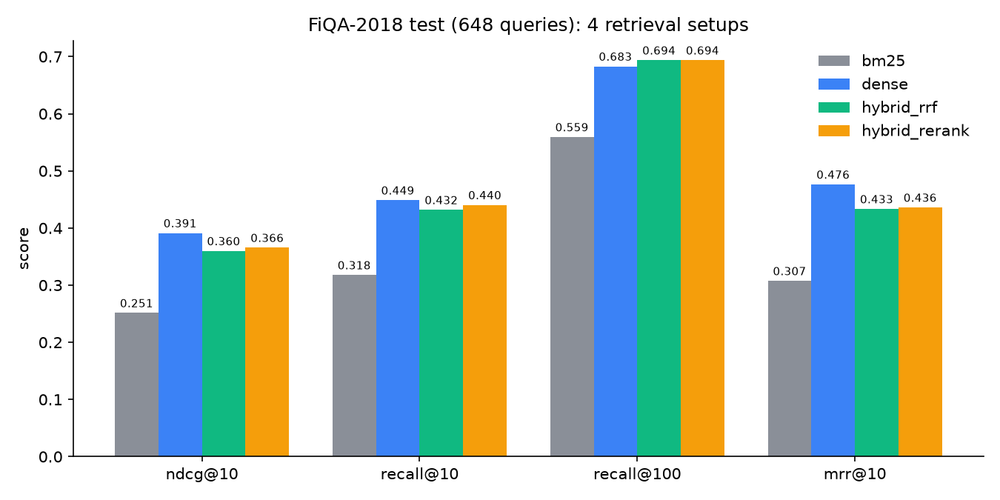

# finance-rag-eval: a measured RAG benchmark on financial QA

I built a retrieval-augmented QA system over BEIR FiQA-2018 (57,638 financial opinion passages) and, instead of just demoing it, measured four retrieval setups on all 648 labelled test queries. Answers are generated locally with Ollama and must cite passage IDs, and a validator checks every citation against the retrieved set.

## Problem
Most RAG demos never measure retrieval. I wanted to know which retriever actually finds the right passages, and whether a small local model stays grounded in them.

## Approach
- Retrievers: BM25 (`bm25s`, English stemming) | dense (`BAAI/bge-small-en-v1.5`, cosine over a numpy matrix) | hybrid (reciprocal rank fusion, k=60, BM25 + dense) | hybrid top-100 reranked by `cross-encoder/ms-marco-MiniLM-L-6-v2`.
- Metrics: nDCG@10, Recall@10, Recall@100, MRR@10, implemented in `src/finrag/metrics.py` with unit tests.
- Generation: top-5 passages of the best retriever go to `qwen2.5:3b` via Ollama. The prompt forces `[doc_id]` citations.
- Serving: FastAPI `POST /ask` and `GET /health`.

## Results (full test split, 648 queries)
Source: `reports/retrieval_metrics.json` (chart: `reports/retrieval_metrics.png`).

| Setup | nDCG@10 | Recall@10 | Recall@100 | MRR@10 | Mean latency / query |
|---|---|---|---|---|---|
| BM25 | 0.2514 | 0.3178 | 0.5593 | 0.3075 | 0.5 ms |
| Dense (bge-small) | **0.3913** | **0.4487** | 0.6830 | **0.4764** | 19.9 ms |
| Hybrid (RRF) | 0.3599 | 0.4317 | **0.6937** | 0.4333 | 20.7 ms |
| Hybrid + cross-encoder rerank | 0.3657 | 0.4404 | **0.6937** | 0.4360 | 661.8 ms |



What I take from this:
- Dense retrieval beats BM25 by a wide margin on FiQA (nDCG@10 0.251 to 0.391).
- Hybrid fusion gave the best Recall@100, but did not beat dense on top-10 quality. A plain RRF of a weak lexical ranker with a strong dense one pulled nDCG@10 down.
- The MS MARCO cross-encoder improved on plain hybrid (0.360 to 0.366) but did not beat dense alone, at about 30x the latency. It is trained on web search, not financial opinion QA, so a domain-tuned reranker is the obvious next try. I did not run one.
- My expectation going in was that hybrid + rerank would win. It did not, so the generator uses the best measured setup (dense).

Latency is wall-clock per query after warm-up, one query at a time, on a laptop RTX 3050 (4 GB) that was shared with other jobs. Treat it as indicative.

### Grounded generation and faithfulness
Source: `reports/generation_eval.json`, 5 examples in `reports/sample_answers.md`.
- Setup: 30 test questions (random sample, seed 0), dense top-5, generator `qwen2.5:3b`.
- Citation check: 28/30 answers cited only retrieved IDs. 0 were uncited. 2 cited an ID outside the retrieved set and were flagged.
- Faithfulness (LLM judge `qwen3.5:4b`, rubric in the JSON): 12 supported, 8 partially, 10 unsupported out of 30.
- Honest caveats: the judge is a small local model and a noisy proxy. I did no human labelling and measured no judge agreement. Only 18/30 questions had a gold passage in the top 5, and FiQA questions are open-ended opinions, so a "supported" answer is not necessarily a correct one. Read this as a smoke test, not a benchmark. n=30 is also small.

## What I built
`src/finrag/` (data, metrics, fusion, retrievers, generate), `api/main.py` (FastAPI), `scripts/` (download, retrieval eval, generation eval), `tests/` (metrics, citation validator, API with the LLM and retriever mocked), `.github/workflows/ci.yml` (ruff + pytest).

## What I'd do next
- Try a domain-tuned or larger reranker (e.g. `bge-reranker-base`) and a weighted fusion instead of plain RRF.
- Check my metrics against `pytrec_eval` (I only unit-tested them).
- Human-label a subset to calibrate the judge; add a UI.

## How to run
```bash
python -m venv .venv && .venv/Scripts/activate    # Python 3.12 recommended
pip install -r requirements.txt                   # use a CUDA torch build if you have a GPU
python scripts/download_data.py                   # ~17 MB BEIR download into data/
python scripts/run_retrieval_eval.py              # builds indexes (~6 min on a 3050), writes reports/
ollama pull qwen2.5:3b && ollama pull qwen3.5:4b
python scripts/run_generation_eval.py
uvicorn api.main:app                              # then POST /ask {"question": "...", "k": 5}
pytest -q && ruff check .
```
Env vars: `GEN_MODEL` (default `qwen2.5:3b`), `RETRIEVER` (API setup: `bm25|dense|hybrid_rrf|hybrid_rerank`, default `dense`, the best measured setup), `OLLAMA_URL`.

## Data source and licence
BEIR FiQA-2018 (Thakur et al., BEIR benchmark; derived from Maia et al., WWW'18 FiQA challenge). The BEIR repo is Apache-2.0; the FiQA data itself comes from the FiQA challenge and public StackExchange/Reddit posts, and BEIR notes its datasets are for research use. Check the upstream terms before any commercial use. Data is downloaded at run time and not committed.

Code: MIT, (c) 2026 Syed Mudaseer Quadri.
